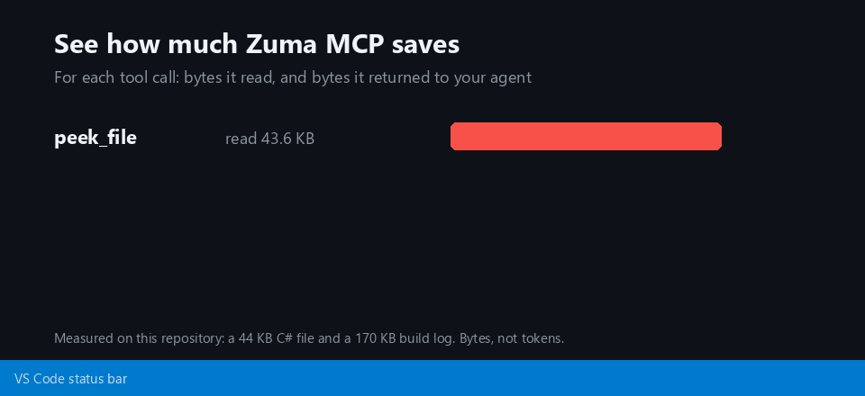

# Changelog

## 0.9.0 (Unreleased)

- Run the Rust MCP front end on every packaged platform. UTF-8 code outlines, Git-aware file search, and log summaries execute locally in Rust; the self-contained C# server is retained as the compatibility core for PowerShell, diagnostics, non-UTF-8 file fallback, symbol reads, and the remaining tools.
- Add optional MCP Tasks execution for long-running PowerShell, build, test, lint, and type-check calls. Task-aware clients can poll results and cancel work while existing clients retain synchronous calls.
- Add `read_symbol` to read exact named code declarations, including Python decorators and overload disambiguation through `occurrence`.
- Add `run_affected_tests`, `run_cargo_check`, `onlyNew` diagnostics, and `regressionsOnly` test reports so callers can focus on changed and newly failing results.
- Keep the first test failure's full assertion message and stack detailed, compact later failures into location-and-cause summaries, and retain the full report separately. Isolate timeout and cancellation reports so interrupted runs do not replace comparison baselines.

## 0.8.2

- Fix the Windows Rust MCP front end so `read_section.ranges` declares its array item schema and VS Code can validate all registered tools.

## 0.8.1

- Fix Linux and macOS Marketplace packaging by invoking the PATH-provided `npx` without a shell while retaining direct npm CLI invocation on Windows.

## 0.8.0

### Windows x64

- The Marketplace package starts with a 0.3 MiB Rust MCP front end. UTF-8 Markdown outlines and line-range reads run in Rust without starting the .NET compatibility process.
- The existing .NET server is bundled as `InazumaPwsh.core.exe` and starts on demand for persistent PowerShell sessions, diagnostics, searches, non-UTF-8 files, and the remaining tool paths.
- Tool names and input contracts remain compatible with 0.7.2. Cancellation notifications are mapped from the Rust request ID to the compatibility process request ID.
- Linux x64, Linux arm64, macOS x64 and macOS arm64 retain the existing .NET server in 0.8.0.

## 0.7.2

### PowerShell sessions

- `execute_powershell` returns `status: "error"` with the message for terminating errors (`throw`, `$ErrorActionPreference = 'Stop'`) and keeps the output produced before the error. Earlier versions reported success with empty output.
- New sessions start in the first workspace folder, or in the home directory when no folder is open, instead of the extension's install directory. The location persists between calls: `Set-Location` in a script and `workingDirectory` both remain in effect for the next call in the same session. This is a behavior change.
- The limit of 6 sessions is enforced: the least recently used idle session is closed, and an error is returned when all sessions are busy.
- New `list_powershell_sessions` tool. `reset_powershell_session` returns `existed: false` for an unknown session.
- `Write-Host` and `Write-Information` output is returned with the normal output. Verbose and debug messages are returned in `warnings` with a `VERBOSE:` or `DEBUG:` prefix.
- The log at `fullLogPath` has one output line per line.

### Test and build tools

- With `compactResponse` (default `true`), all test tools remove from `output` the failure blocks, progress lines and tool-internal lines already covered by `failures`, and keep summaries and errors outside tests.
- `run_tsc` with `onlyNew` leaves out compiler lines for diagnostics that are not new.
- `run_dotnet_test` returns `rerunArgs` with a `--filter` for the failed tests, drops framework frames from stacks, keeps truncated lines in order, and no longer copies failed tests into `globalErrors`.
- `run_pytest` reports unexpected exceptions as `status: "error"` and counts them in `stats.errors`, separately from assertion failures.
- `run_dotnet_build` reports MSBuild errors without a file (for example MSB1009), adds `codeContext` to warnings, and counts info-level diagnostics in `totalInfos` instead of warnings.
- `run_playwright` returns absolute attachment paths. `run_bun_test` reports a `-t` filter that matches no tests as an error. `run_vitest` returns Vitest's summary in `output`.
- `inspect_playwright_trace` accepts a relative `tracePath` with `workingDirectory`, strips ANSI codes, returns `stack` as an array of frames, no longer repeats the test failure in `uncaughtErrors`, and puts "Trace file not found" in `errors`.

### File-reading tools

- `peek_file` lists C# expression-bodied members, starts Python ranges at the first decorator, and accepts `maxLevel`.
- `read_section` rejects a start line after the end line, suggests the closest headings and body matches when nothing matches, and reads up to 10 `ranges` in one call.
- `search_files` adds `maxPerFile`, `literal`, `contextLines` and `exclude`, respects `.gitignore`, and keeps leading indentation.
- `summarize_log` also matches エラー, 警告, 失敗 and 例外, and ignores zero-count summary lines.

## 0.7.1

- Count `execute_powershell`, `search_files`, session resets, trace inspection, and diagnostic calls without a measurable source size. Exclude these calls from the savings percentage and show the total call count in the status bar.

## 0.7.0

- `peek_file` returns each outline entry as one string, `"start-end level title"`, instead of an object with `start`, `end`, `level`, and `title`. This is a behavior change.
- `summarize_log` no longer repeats the matched line inside `context`; it is returned once as `text` at `firstLine`. This is a behavior change.
- With `contextLines`, `codeContext` skips lines already returned for an earlier item of the same file (the item's own line is kept), and the `output` of `run_tsc` leaves out compiler lines that `diagnostics` lists with their whole message. This is a behavior change.

## 0.6.1

- The MCP server is shown as `Zuma` in VS Code.
- PowerShell outlines use PowerShell's parser without executing the file. Markdown outlines respect the length of fenced code blocks. PowerShell outline queries start a separate PowerShell process and may take longer.

## 0.6.0

### See how much you save

The status bar now shows what Zuma MCP saved, for example `95% saved`. Click it, or run **Zuma MCP: Show Savings**, for the breakdown by tool: number of calls, bytes read, and bytes returned.

- The diagnostic tools, `peek_file`, `read_section`, and `summarize_log` append the bytes they read (the file, or the full log of a run) and the bytes they returned to `%TEMP%/inazuma-pwsh-logs/usage.jsonl`. The status bar item totals that file and appears after the first recorded call.
- The percentage compares, for each call, the size of what the tool read with the size of its response. It is not a token count and not a whole-chat measurement. `execute_powershell` and `search_files` are not recorded.
- The numbers in the animation were measured with 0.6.0 on this repository: a 44 KB C# file (`peek_file`, `read_section`) and a 170 KB build log (`summarize_log`). The animation is an illustration, not a screen recording.

### New tools and options

- **`run_dotnet_test`.** Runs `dotnet test` and returns test counts and failures with file, line, message, and stack from its TRX reports. VSTest is verified with a mock project; the Microsoft.Testing.Platform path (selected by `global.json`) has not been run against a real project.
- **`run_eslint`.** Runs the locally installed ESLint and returns error and warning counts, per-rule counts, and the first 15 problems.
- **`search_files`.** Searches text files under a directory with a regex and returns per-file match counts and the first matching lines in at most 8,000 characters. It skips `.git`, `node_modules`, `.venv`, binary files, and files over 5 MB, and does not apply `.gitignore`.
- **`contextLines` for `run_dotnet_build`.** Compiler errors can carry `codeContext` like the test tools. `codeContext` is added only for files under `workingDirectory`.
- **`rerunArgs`.** Failed test runs return arguments that rerun only the failures: failing files for `run_bun_test` and `run_vitest`, `--lf` for `run_pytest`, `--last-failed` for `run_playwright`, and a `--filter` expression for `run_dotnet_test` (VSTest). It is omitted when the report does not list every failure.
- **Same-cause failures are grouped.** `run_bun_test`, `run_pytest`, `run_vitest`, and `run_dotnet_test` report failures at the same file and line with the same message once, with `count`.
- **`run_tsc` additions.** `onlyNew: true` lists only diagnostics that the previous run with the same `workingDirectory` and `tscArgs` did not have, with `newCount` and `fixedCount`; the previous result is kept in memory until the server stops. `--build` and `-b` are accepted and omit `--noEmit`.

## 0.5.4

- **Windows finds PowerShell 7 outside `PATH`.** If `pwsh.exe` is not on the `PATH` that VS Code inherited (for example, PowerShell was installed after VS Code started), the server also checks `%ProgramFiles%\PowerShell\7`, `%LOCALAPPDATA%\Microsoft\WindowsApps` (Microsoft Store) and `%USERPROFILE%\.dotnet\tools`. Previously the server exited with only an exit code.
- **Clear startup error.** If PowerShell 7 still cannot be found, the server writes `InazumaPwsh cannot start:` with the remedy to its output log and exits with code 1 instead of an unhandled exception.

## 0.5.0

- **`run_tsc`.** Runs the locally installed TypeScript compiler without emitting files and returns diagnostics with file, line, column, code, and message, using the same bounded responses as the other diagnostic tools.
- **`contextLines` for the diagnostic tools.** Shows 0 to 10 source lines around each failure location as `codeContext` (default 0 = off). `summarize_log` also takes `contextLines` (0 to 5, default 1) and drops context first when the response is trimmed.
- **Linux and macOS (experimental).** The server now builds for the host platform. The project is tested locally only on Windows (41 of 41 checks pass); a Linux/macOS/Windows CI matrix is added but has not run yet. Linux and macOS have no Job Object, so a crashed server can leave worker processes behind. The pwsh override is still `INAZUMA_PWSH_PATH` or the `inazumaPwsh.pwshPath` setting.
- **Rename.** The display name is now Zuma MCP; the extension ID stays `ShunsukeF.inazuma-pwsh`. Setting keys, environment variables, executable names, and the log folder keep their `inazuma` names for compatibility.

## 0.4.1

0.4.1 shortens responses and reduces idle resource use.

- **Complex objects return text.** Output such as `Get-ChildItem` or `Get-Item` (FileInfo, Process and other .NET objects) is returned as formatted text instead of a depth-5 JSON tree that could reach tens of megabytes. Strings, numbers, hashtables, `[pscustomobject]` and arrays of them still return structured `data`; JSON depth is now 3. Use `ConvertTo-Json` in the script when you need full structure.
- **Shorter responses.** Empty `errors`/`warnings`, `isTruncated: false`, `exitCode: 0`, null `data`/`output`/`fullLogPath` and `stats` are omitted. `stats`, `isTruncated` and `fullLogPath` appear only when output is truncated. This is a behavior change for clients that read these fields unconditionally.
- **Lazy default session.** The server no longer starts a `default` PowerShell worker at launch; it starts on first use. The pwsh path and worker script are still validated at startup.
- **Session reclaim.** Idle sessions (including `default`) expire after 10 minutes. At the six-session limit, the least recently used idle session is evicted instead of failing.
- **Log cleanup.** At startup, files in `%TEMP%/inazuma-pwsh-logs/` older than 3 days are deleted, and the oldest are deleted while the total exceeds 200 MB.

## 0.4.0

0.4.0 helps your agent read less to find what it needs, and removes wasted characters from every response.

### New file-reading tools

Instead of loading a whole file into the conversation, your agent can look at its structure first and then read only the part it needs.

- **`peek_file`** returns the file type, encoding, line count, and an outline with line ranges: Markdown headings (code fences ignored), C#/TypeScript/JavaScript/PowerShell/Python/Go/Rust/VB declarations, JSON keys, and YAML keys. It also recommends `FULL` for short files (200 lines or fewer by default) or `PARTIAL` for longer ones.
- **`read_section`** returns one outline entry found by a title search (`query`), or an explicit `startLine`/`endLine` range, with line numbers. Long ranges stop at `maxChars` and give the `nextLine` to continue from.
- **`summarize_log`** groups lines that match a pattern (by default `error|fail|exception|fatal|warn`) after replacing digits, so repeated errors appear once with a count, first and last line, and context. It also returns the last lines of the log. Use it on build logs or on a `fullLogPath`.

All three require an existing absolute path, accept files up to 50 MB, read UTF-8 (with or without BOM) and UTF-16 with BOM, and fall back to Shift_JIS for non-UTF-8 text. `summarize_log` also strips ANSI color codes.

Measured examples: on a 68,000-character Markdown design document, `peek_file` returned 7% of the original characters, and `peek_file` plus one `read_section` call returned 20%. On a 137,000-character execution log, `summarize_log` returned 1%. These are single-file measurements; savings across complete chats have not been measured.

### Smaller responses

- **No unnecessary escaping.** Responses previously escaped quotes, `<`, `>`, `&`, `+`, and every non-ASCII character as `\uXXXX`, so each Japanese character took six characters. Responses now keep these characters as-is; quotes inside strings use the shorter `\"`.
- **`compactResponse` now defaults to `true`.** `output` is omitted when it exactly duplicates `data`. Pass `compactResponse: false` to always receive `output`. This is a behavior change.
- **Redirected stderr stays plain text.** Native command stderr merged with `2>&1` was returned as a fully serialized error object, often thousands of characters per line. It is now returned as the line's text.

### Fixes

- **Japanese output from native commands.** Workers now set the console input and output encoding to UTF-8, so output from commands such as `git log` is no longer garbled.

## 0.3.0

`run_bun_test`, `run_pytest`, and `run_vitest` joined `run_dotnet_build` and `run_playwright`. They return test counts and failures with file, line, and message, using the status values `success`, `error`, `no_tests`, or `report_unavailable`. A run without a usable report is never reported as `success`. Responses are limited to 8,000 characters and list at most 10 failures; the full log is saved for follow-up searches.
