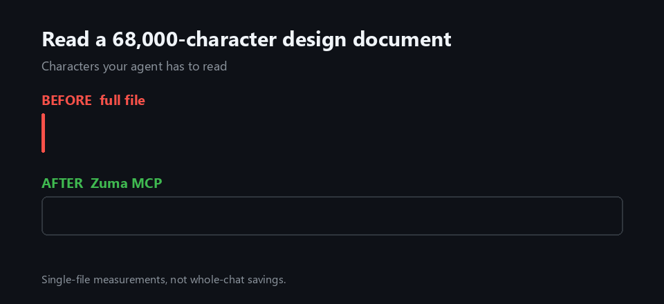
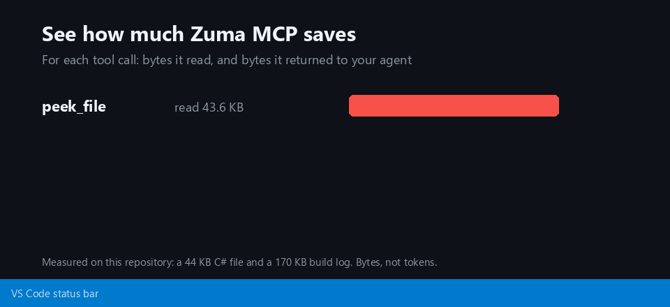

# Zuma MCP: Context & Log Optimizer for AI Coding

**Your coding agent reads 7% of a design document and 1% of a build log—not 100%.**

| Input | Full read | With Zuma MCP | Characters returned |
| --- | --- | --- | --- |
| 68,000-character Markdown design document | 68,000 | `peek_file` | **7%** (about 4,760) |
| same document | 68,000 | `peek_file` + one `read_section` | **20%** (about 13,600) |
| 137,000-character execution log | 137,000 | `summarize_log` | **1%** (about 1,370) |

These are single-file measurements. Savings across complete chats have not been measured.

Zuma MCP (formerly InazumaPwsh) gives your VS Code coding agent a native Rust file/search engine, structured build and test diagnostics, persistent local PowerShell 7 sessions, and a compact chat handoff. Instead of loading entire files and terminal dumps into chat, inspect an outline, read an exact symbol or section, summarize a log, run only affected tests, or hand the next chat only the goal, changed files, latest verification, and next action.

## Why Developers Use Zuma MCP

- **Cut context bloat:** Inspect file outlines, read exact symbols or sections, and summarize logs before loading raw text into chat.
- **Start on native Rust:** Every packaged platform starts a lightweight Rust MCP front end for UTF-8 file outlines, Git-aware search, and log summaries.
- **Find only new regressions:** Run tests affected by Git changes, filter compiler and lint diagnostics to new findings, and keep only newly failing test transitions.
- **Stop repeated failures:** Trip a circuit breaker when the same command, Git diff, and failure recur, and block unscoped full suites during incremental work.
- **Keep shell state alive:** Reuse variables, modules, import state, and the current directory across PowerShell calls in a dedicated chat session.
- **Non-blocking long work:** Task-aware MCP clients can poll and cancel PowerShell, build, test, lint, and type-check operations while existing clients keep synchronous calls.
- **Automatic VS Code integration:** The extension registers its MCP server and bundles the Rust front end, C# compatibility core, and PowerShell worker. No manual `mcp.json` setup is required.

## Available Tools (26 Tools)

### Task anchor

| Tool | Purpose |
| --- | --- |
| `set_task_anchor` | Register the current goal, target, acceptance criteria, out-of-scope items, and absolute allowed paths. Zuma appends the anchor to later tool responses. |
| `get_task_anchor` | Return the active task anchor. |
| `clear_task_anchor` | Clear the active task anchor after the task is complete or when a new unrelated task starts. |

Set an anchor once at the start of a substantial task and update it when the goal or scope changes. Path-bearing tool calls outside `allowedPaths` return a `scopeWarnings` entry; this is a reminder, not a filesystem sandbox. Anchor state stays in the Zuma server process and is not persisted with the chat or included in handoff logs.

### Execution Gate

| Tool | Purpose |
| --- | --- |
| `get_execution_gate` | Return the current `manual`, `incremental`, or `milestone` mode, repeat threshold, and tripped circuits. |
| `set_execution_gate` | Change the mode and gate thresholds for the current server process. |
| `reset_execution_gate` | Clear repeat-failure history and tripped circuit state. |

The circuit breaker is shared by typed diagnostic tools and test commands run through `execute_powershell`. It compares the command, structured failure signature, and Git diff. The default threshold is three identical failures. In `incremental` mode, an unscoped full test run is blocked and the agent is directed to `run_affected_tests` or a specific test target. `milestone` permits full suites.

### Persistent PowerShell 7 Sessions

| Tool | Purpose |
| --- | --- |
| `execute_powershell` | Run a script in a persistent session and return structured data, output, errors, exit code, and `fullLogPath` when truncated. |
| `list_powershell_sessions` | List active sessions with location, creation time, last-used time, and busy state. |
| `reset_powershell_session` | Recreate one worker and its session state. Files and OS environment settings are not reverted. |

### Structured diagnostics

| Tool | Purpose |
| --- | --- |
| `run_dotnet_build` | Run a build and return the exit code and SARIF compiler diagnostics. Warnings are omitted by default. |
| `run_dotnet_test` | Run `dotnet test` and return test counts and failures with file, line, message, and stack from its TRX reports. |
| `run_affected_tests` | Select tests from Git changes, untracked files, naming conventions, and relative imports, then run each detected runner once. |
| `run_playwright` | Run locally installed Playwright and return test counts, failures, and attachment paths from its JSON report. |
| `inspect_playwright_trace` | Inspect a trace ZIP for failed actions, HTTP and console errors, and a DOM excerpt. |
| `run_bun_test` | Run `bun test` and return test counts and failures with file, line, message, and stack from its JUnit XML report. |
| `run_pytest` | Run pytest and return test counts and failures with file, line, and message from its JUnit XML report. |
| `run_vitest` | Run locally installed Vitest once (`vitest run`) and return test counts, failures, and file-level errors from its JSON report. |
| `run_tsc` | Run the locally installed TypeScript compiler (`tsc --noEmit`) and return diagnostics with file, line, column, code, and message. |
| `run_eslint` | Run the locally installed ESLint and return counts, per-rule counts, and problems with file, line, column, rule, and message. |
| `run_cargo_check` | Run `cargo check` and return Rust compiler errors and warnings with file, line, column, code, and message. |

### File and log reading

| Tool | Purpose |
| --- | --- |
| `peek_file` | Return a text file's type, encoding, line count, outline with line ranges, and a `FULL` or `PARTIAL` reading recommendation. |
| `read_section` | Return one outline entry by title search, or a line range, with line numbers and a `nextLine` for continuation. |
| `read_symbol` | Return one exact named declaration from a code file, including decorators and the complete symbol range. Overloads can be selected with `occurrence`. |
| `summarize_log` | Group matching log lines with counts and context, and return the last lines of the log. |
| `search_files` | Search text files under a directory with a regex and return per-file match counts and the first matching lines. |

### Chat handoff

| Tool | Purpose |
| --- | --- |
| `prepare_handoff` | Replays an explicitly selected VS Code chat session and returns a bounded local summary with Git state, the latest Zuma verification, and the next action. |

Handoff access is disabled by default. Enable `inazumaPwsh.handoff.enabled` in a trusted workspace, then call `prepare_handoff` without a session to list candidates. Select one `sessionId` or `sessionPath` for a second call and pass `nextActionHint`. Zuma does not read an unsent editor draft as the next action, never silently chooses the newest chat, and never saves the handoff unless a client explicitly keeps the returned text.

### Native Rust + C# Architecture

Every packaged platform starts the Rust MCP front end for UTF-8 Markdown and code outlines, explicit line ranges, Git-aware search, and log summaries. It forwards PowerShell sessions, AST parsing, symbol reads, non-UTF-8 fallback, and build/test diagnostics to the self-contained C# compatibility core when required.

### Asynchronous tool calls

Clients using MCP protocol revision `2026-07-28` and the `io.modelcontextprotocol/tasks` extension can request PowerShell, build, test, lint, and type-check tools as MCP Tasks. Clients without Tasks opt-in retain synchronous responses. File-reading, log, and trace tools remain synchronous.

## Try it in a chat

After installing the extension and approving its MCP tools, ask your agent to use Zuma MCP. For example:

- "Use a dedicated Zuma MCP session for this chat. Set a task anchor for the target, acceptance criteria, and allowed paths. Load my module, then reuse it for the next commands."
- "Build this .NET project with Zuma MCP. Keep the task anchor focused on this build, then show the compiler errors first and consult the full log if compilation is outside the report."
- "Run this project's Playwright tests and summarize the failures and available trace paths."
- "Inspect this Playwright trace for failed actions, HTTP errors, and console errors."
- "Run the pytest suite with Zuma MCP and fix the first failure."
- "Run `bun test` with Zuma MCP and show me the failing files and lines."
- "Run Vitest with Zuma MCP for `src/utils` only and explain why the import failed."
- "Peek at this design document with Zuma MCP, then read only the section about approvals."
- "Read the `RunAsync` symbol in this C# file, then fix the cancellation path."
- "Summarize the errors in this build log with Zuma MCP before opening it."
- "List safe chat-handoff candidates, let me choose one, then prepare the next chat context."

The agent must choose and reuse a unique `sessionId` to keep chat state separate. Trace inspection complements browser-based visual checks; it does not verify how a page looks.

## What's new in 0.12.0

- **Task anchors.** Register the goal, target, acceptance criteria, out-of-scope items, and allowed paths once with `set_task_anchor`; later tool responses repeat the anchor so long chats retain the intended scope.
- **Scope drift warnings.** File, trace, Python, and working-directory arguments outside `allowedPaths` add `scopeWarnings` to the reminder.
- **Synchronous and asynchronous coverage.** Anchors are attached to normal tool responses and MCP task creation or polling results, with bounded local state that is never persisted to chat logs.

## What's new in 0.11.0

- **Safe chat handoff.** `prepare_handoff` lists candidate VS Code chat sessions, requires explicit selection, replays the current JSONL delta format, and returns a bounded local summary with Git state, the latest Zuma verification, and the next action.
- **Opt-in privacy controls.** Handoff is disabled by default. It redacts credential-like values and URL query strings, rejects unsupported or oversized logs, and records byte savings without uploading or persisting chat text.
- **Marketplace clarity.** The listing title now says what Zuma does: `Zuma MCP: Context & Log Optimizer for AI Coding`.

## What's new in 0.10.0

- **Execution-loop circuit breaker.** The same normalized command, Git diff, and structured failure signature can be recorded across typed diagnostics and persistent PowerShell test commands. At the configured threshold, the next execution is blocked until the diff changes or the gate is reset.
- **Incremental and milestone test modes.** `incremental` blocks unscoped full test runs and points agents to `run_affected_tests` or a specific target. `milestone` allows full regressions. The default `manual` mode preserves existing test scope behavior.
- **VS Code controls.** Configure gate policy in `inazumaPwsh.executionGuard.*`, change mode from the Zuma status bar, and use **Zuma MCP: Reset Execution Gate** to start a fresh failure history.
- **Optional Red-phase guard.** Set `inazumaPwsh.executionGuard.skipRedPhase` to block test execution while only test files changed. It is disabled by default to avoid rejecting legitimate reproduction or test-infrastructure work.

## What's new in 0.9.0

- Every packaged platform starts the Rust front end. UTF-8 code outlines, Git-aware search, and log summaries run locally, while the C# compatibility core retains PowerShell, diagnostics, symbol reads, and non-UTF-8 fallback.
- Long-running PowerShell, build, test, lint, and type-check calls can return MCP Tasks for polling and cancellation. Clients without Tasks opt-in keep synchronous responses.
- `read_symbol` reads exact declarations and resolves overloads with `occurrence`. Test and diagnostic tools add affected-test selection, new-diagnostic filtering, regression-only reports, Rust checks, and bounded failure reports. The first failure keeps its full assertion message and stack; later failures use compact summaries, while the full report remains available separately.

## What's new in 0.8.2

This patch fixes the Windows Rust MCP front end so `read_section.ranges` declares its array item schema and VS Code can validate all registered tools.

## 0.8.1

This patch fixes Linux and macOS packaging so all platform variants can be published consistently.

## 0.8.0

On Windows x64, the Marketplace package starts a 0.5 MiB Rust MCP front end. UTF-8 Markdown outlines and explicit line ranges run locally in Rust. The existing .NET server is included as a compatibility process and starts on demand for persistent PowerShell, diagnostics, search, encoding fallback, and other tool paths. All 16 tool names and responses remain available. The other four platform packages continue to use the .NET server in 0.8.0.

## What's new in 0.7.0

This release changes response formats to reduce repeated output:

- `peek_file.entries` now contains `"start-end level title"` strings instead of objects with `start`, `end`, `level`, and `title`.
- `summarize_log` keeps each matched line as `text` at `firstLine`, without repeating it in `context`.
- `codeContext` skips lines already returned for an earlier item in the same file, keeping each item's own line. `run_tsc` omits raw compiler lines from `output` when `diagnostics` already contains their full message.

## What's new in 0.6.x

### 0.6.1

- The MCP server is shown as `Zuma` in VS Code.
- PowerShell outlines use PowerShell's parser without executing the file. Markdown outlines respect the length of fenced code blocks. PowerShell outline queries start a separate PowerShell process and may take longer.

### 0.6.0

#### See how much you save

The status bar now shows what Zuma MCP saved, for example `95% saved`. Click it, or run **Zuma MCP: Show Savings**, for the breakdown by tool: number of calls, bytes read, and bytes returned.

- The status bar shows recorded calls and the savings measured for diagnostic tools, `peek_file`, `read_section`, and `summarize_log`. The records are stored in `%TEMP%/inazuma-pwsh-logs/usage.jsonl`.
- Calls without a comparable source size, including `execute_powershell` and `search_files`, are counted but excluded from the savings percentage. The percentage is not a token count or a whole-chat measurement.
- The numbers in the animation were measured with 0.6.0 on this repository: a 44 KB C# file (`peek_file`, `read_section`) and a 170 KB build log (`summarize_log`). The animation is an illustration, not a screen recording.

#### New tools and options

- **`run_dotnet_test`.** Runs `dotnet test` and returns test counts and failures with file, line, message, and stack from its TRX reports. VSTest is verified with a mock project; the Microsoft.Testing.Platform path (selected by `global.json`) has not been run against a real project.
- **`run_eslint`.** Runs the locally installed ESLint and returns error and warning counts, per-rule counts, and the first 15 problems.
- **`search_files`.** Searches text files under a directory with a regex and returns per-file match counts and the first matching lines in at most 8,000 characters. It skips `.git`, `node_modules`, `.venv`, binary files, and files over 5 MB, and respects Git ignore rules.
- **`contextLines` for `run_dotnet_build`.** Compiler errors can carry `codeContext` like the test tools. `codeContext` is added only for files under `workingDirectory`.
- **`rerunArgs`.** Failed test runs return arguments that rerun only the failures: failing files for `run_bun_test` and `run_vitest`, `--lf` for `run_pytest`, `--last-failed` for `run_playwright`, and a `--filter` expression for `run_dotnet_test` (VSTest). It is omitted when the report does not list every failure.
- **Same-cause failures are grouped.** `run_bun_test`, `run_pytest`, `run_vitest`, and `run_dotnet_test` report failures at the same file and line with the same message once, with `count`.
- **`run_tsc` additions.** `onlyNew: true` lists only diagnostics that the previous run with the same `workingDirectory` and `tscArgs` did not have, with `newCount` and `fixedCount`; the previous result is kept in memory until the server stops. `--build` and `-b` are accepted and omit `--noEmit`.

Release notes for all versions are in [CHANGELOG.md](https://github.com/furukawa658/inazuma-pwsh/blob/v0.11.0/CHANGELOG.md).

## Requirements and installation

- VS Code 1.101 or later. Windows x64 is the verified platform; Linux (x64, arm64) and macOS (x64, arm64) are supported but experimental (see "Notes").
- External PowerShell 7 (`pwsh.exe` on Windows, `pwsh` on Linux/macOS) installed on the system (only PowerShell 7.7.0 has been verified in practice). The server searches `PATH` first, then the standard install locations (Windows: `%ProgramFiles%\PowerShell\7`, `%LOCALAPPDATA%\Microsoft\WindowsApps`, `%USERPROFILE%\.dotnet\tools`; Linux/macOS: `/opt/homebrew/bin`, `/usr/local/bin`, `/usr/bin`, `/snap/bin`, `~/.dotnet/tools`), or you can specify an explicit executable path via the `inazumaPwsh.pwshPath` setting or `INAZUMA_PWSH_PATH` environment variable. An invalid explicit path fails immediately without fallback.
- The extension bundles a Rust MCP server, a self-contained C# compatibility core, and the worker script (`powershell-worker.ps1`) for every platform. The worker script runs under the external PowerShell 7 process to manage session runspaces.
- A trusted workspace. The extension runs in the local extension host, including when a remote workspace is open; it does not switch to the remote shell or filesystem.
- Install the VSIX for your platform (win32-x64, linux-x64, linux-arm64, darwin-x64 or darwin-arm64) using **Extensions: Install from VSIX** or from the Visual Studio Code Marketplace. The extension registers its MCP server automatically; no `mcp.json` entry is required. Follow VS Code's prompts to trust the workspace, start the server, and approve tool calls.
- Build diagnostics require the .NET SDK; Playwright diagnostics require Node.js and a locally installed Playwright package. `run_bun_test` requires Bun on `PATH`, `run_pytest` requires a Python interpreter with pytest installed, and `run_vitest` requires Node.js and a locally installed Vitest package.

## Related tools

| When you need... | Extension | Role |
| --- | --- | --- |
| Long-term recall across chats | [Kioku](https://marketplace.visualstudio.com/items?itemName=ShunsukeF.kioku-search) | Saves and searches lessons from earlier tasks. |
| Overnight continuation with a credit limit | [Eien](https://marketplace.visualstudio.com/items?itemName=ShunsukeF.eien) | Resumes stalled work and stops at the configured budget. |
| A fresh chat before context gets overloaded | [Tsugi](https://marketplace.visualstudio.com/items?itemName=ShunsukeF.tsugi) | Creates a reviewed handoff prompt for the next chat. |
| A reusable workflow from a completed task | [Waza](https://marketplace.visualstudio.com/items?itemName=ShunsukeF.waza) | Compiles a selected workflow into an Agent Skill. |

The Zuma MCP project code is licensed under the MIT License, copyright 2026 Shunsuke F. Bundled third-party components retain their own licenses; see `LICENSE` and `THIRD-PARTY-NOTICES.txt` for details. Repository: https://github.com/furukawa658/inazuma-pwsh

## Notes

- Zuma MCP was formerly InazumaPwsh; the extension ID (`ShunsukeF.inazuma-pwsh`), setting keys (`inazumaPwsh.*`), environment variables, executable names, and the log folder keep their inazuma names for compatibility.
- Linux and macOS are experimental. On Linux/macOS there is no Job Object, so workers may be orphaned if the server process crashes.
- Details on sessions, output limits, cancellation, execution gates, and building from source are in [docs/reference.md](https://github.com/furukawa658/inazuma-pwsh/blob/v0.11.0/docs/reference.md).

### Sessions and output

- Choose a unique `sessionId` for each chat and reuse it within that chat. If omitted, calls share the `default` session. Calls with the same ID run sequentially; different IDs can run concurrently.
- Variables, modules, and the current location are retained per session until `reset_powershell_session` or an unexpected worker process termination. This separation is not a security boundary.
- There are at most six sessions, including `default`. Idle sessions expire after 10 minutes.
- `maxOutputChars` limits `output` to 1,000 through 50,000 characters, with a default of 6,000. When output is truncated, the full log is saved locally.

Timeouts, `compactResponse`, Python standard input, MCP Tasks, execution gates, and the limits of each diagnostic tool are described in [docs/reference.md](https://github.com/furukawa658/inazuma-pwsh/blob/v0.11.0/docs/reference.md).

### Safety and logs

Scripts run with the current user's permissions. Zuma MCP is not a security sandbox, and syntax checks do not restrict unauthorized system operations. Connect only trusted local clients, and do not put credentials in scripts. Avoid interactive commands, GUI prompts, authentication prompts, and elevation requests.

Full logs are saved as UTF-8 under `%TEMP%/inazuma-pwsh-logs/`. `fullLogPath` identifies an execution log; `fullReportPath`, when present, identifies detailed structured diagnostics. Logs older than 3 days, or beyond 200 MB in total, are deleted at server startup, and they may contain sensitive output. Review and remove them when no longer needed.

Cancellation and timeout behavior is described in [docs/reference.md](https://github.com/furukawa658/inazuma-pwsh/blob/v0.11.0/docs/reference.md).

### Build and verification

Build commands, reproducibility notes, and the limits of the test suite are in [docs/reference.md](https://github.com/furukawa658/inazuma-pwsh/blob/v0.11.0/docs/reference.md).
